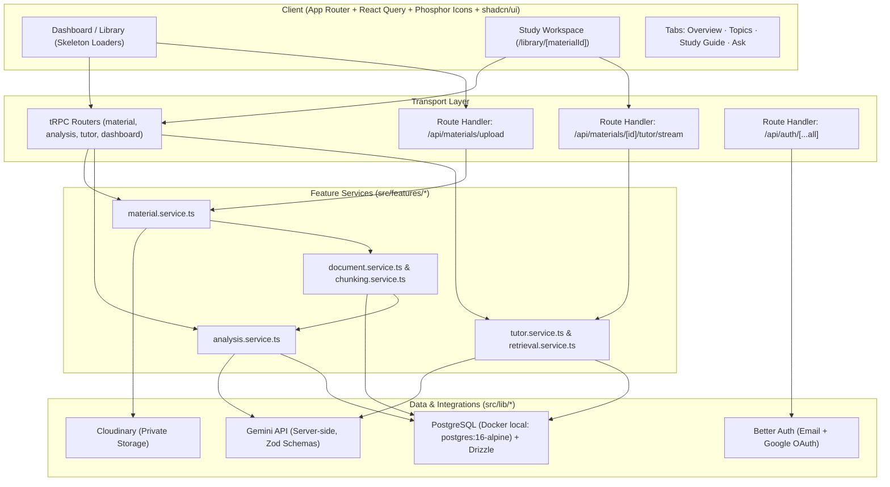

# Sivva Phase 1 — Implementation Plan (Finalized)

> **Scope:** Phase 1 (Upload & Understand) as defined in [SPEC.md](file:///home/monaski/workspace/sivva/SPEC.md) and [AGENTS.md](file:///home/monaski/workspace/sivva/AGENTS.md).
> **Goal:** Allow a student to upload course materials (PDF/DOCX), automatically generate a structured study breakdown (topics, overview, key concepts, glossary), navigate the content, and ask questions grounded in the material with source citations.

---

## Locked-In Architectural Decisions

1. **Local Database**: Docker Compose running `postgres:16-alpine` on port 5432 with healthchecks and a persistent volume.
2. **Retrieval Strategy**: Standard PostgreSQL full-text search (`tsvector` / trigram) preserving page and section citations — keeping the setup lean with zero extra vector dependencies.
3. **Extraction & Processing Strategy**:
   - Direct server-side parsing (`unpdf` for PDF, `mammoth` for DOCX).
   - **Fast upload response with in-process background processing**: The upload route handler uploads the file to Cloudinary, creates the database record with `status: "processing"`, and returns immediately (<2s).
   - In-process background task (using Next.js `after()` or async feature service) performs extraction, chunking, and Gemini analysis without requiring Redis or BullMQ.
   - The UI redirects immediately to `/library/[materialId]` and renders skeleton loaders while polling `material.getStatus` until `ready`.
4. **Icons**: Phosphor Icons (`@phosphor-icons/react`).
5. **Authentication**: Better Auth with Email/Password + Google OAuth Sign In, backed by PostgreSQL / Drizzle ORM.
6. **UI & Loading States**: Tailwind CSS v4 + shadcn/ui adhering to design tokens. **Skeleton loaders** everywhere data is loaded — no plain "Loading..." text.
7. **No Mocks Policy**: Live API integration only; any temporary mocks or test fixtures are confined strictly to a single dedicated top-level directory (`/mocks`).

---

## Architecture Flow

---

## Staged Implementation Plan

### Stage 1: Foundation, Local Docker Postgres & Design System Setup
- [x] **Docker Setup**: Create `docker-compose.yml` with `postgres:16-alpine` (port 5432, healthcheck, persistent volume `pgdata`).
- [x] **Project Realignment**: Move `app/` into `src/app/` to match `AGENTS.md` spec and update `tsconfig.json` path mappings (`@/*` -> `./src/*`).
- [x] **Dependency Installation (`bun`)**:
  - Icons: `@phosphor-icons/react`
  - UI Utilities: `clsx`, `tailwind-merge`, `class-variance-authority`
  - Validation: `zod`
  - Database & Auth: `drizzle-orm`, `drizzle-kit`, `pg`, `@types/pg`, `better-auth`
  - API & State: `@trpc/server`, `@trpc/client`, `@trpc/react-query`, `@tanstack/react-query`, `superjson`
- [x] **Environment Validation (`src/lib/env.ts`)**:
  - Strict Zod schema for `DATABASE_URL`, `BETTER_AUTH_SECRET`, `BETTER_AUTH_URL`, `GOOGLE_CLIENT_ID`, `GOOGLE_CLIENT_SECRET`, `GEMINI_API_KEY`, `CLOUDINARY_CLOUD_NAME`, `CLOUDINARY_API_KEY`, `CLOUDINARY_API_SECRET`.
- [x] **Design System & Tokens**:
  - Tailwind CSS v4 variables from `design/sivva-design-system.png`:
    - Primary Forest Green (`#0F5132`), Secondary Sage Green (`#A7C957`), Mint Accent (`#E8F5E9`), Background (`#FAFAF8`), Surface (`#FFFFFF`), Muted (`#F3F4F6`), Border (`#E5E7EB`), Foreground (`#111827`).
  - Font Plus Jakarta Sans and token scales.
  - Base UI components: Button, Input, Skeleton.

---

### Stage 2: Database Schema & Authentication (Email + Google)
- [x] **Drizzle Schema (`src/lib/db/schema/`)**:
  - `auth.ts`: Better Auth tables (user, session, account, verification) with Google provider support.
  - `materials.ts`: Material metadata, file type (`pdf`, `docx`), Cloudinary ID/URL, status (`pending`, `processing`, `ready`, `error`).
  - `documents.ts`: Raw extracted text, page count, material ID.
  - `chunks.ts`: Chunk text, page number, section heading, document ID, full-text tsvector index.
  - `topics.ts`: Title, summary, order, material ID.
  - `study-guides.ts`: Overview markdown, key concepts (`[{term, definition}]`), key terms glossary (`string[]`).
  - `conversations.ts`: Material ID, User ID, messages (`[{role, content, citations}]`).
- [x] **Database Connection & Migrations**:
  - Setup Drizzle client connecting to local Docker PostgreSQL.
  - Initial schema migration generated in `drizzle/0000_bright_loki.sql`.
- [x] **Better Auth Setup (`src/lib/auth/auth.ts`, `auth-client.ts`)**:
  - Server configuration with email/password and Google OAuth via Drizzle adapter.
  - Route handler `src/app/api/auth/[...all]/route.ts`.
  - Auth UI: `/login` and `/register` with Phosphor icons and design tokens.

---

### Stage 3: tRPC Transport & App Shell
- [ ] **tRPC Infrastructure (`src/server/trpc/`)**:
  - `context.ts`: Session resolution from Better Auth.
  - `init.ts`: Base procedure and error formatting.
  - `middleware.ts`: Authenticated guard (`protectedProcedure`).
  - `routers/_app.ts`: Root app router.
  - `create-caller.ts`: Server caller for Server Components.
- [ ] **Client Integration**:
  - Provider in `src/lib/trpc/Provider.tsx` combining TanStack React Query and tRPC client.
  - Route handler `src/app/api/trpc/[trpc]/route.ts`.

---

### Stage 4: Document Ingestion, Parsing & Chunking
- [ ] **Storage Adapter (`src/lib/storage/cloudinary.ts`)**:
  - Private Cloudinary upload and signed resource access.
- [ ] **Extractors (`src/features/documents/extractors/`)**:
  - `pdf.extractor.ts`: Direct server-side parsing by page.
  - `docx.extractor.ts`: Server-side extraction with mammoth preserving headings.
- [ ] **Chunking Service (`src/features/documents/services/chunking.service.ts`)**:
  - Text chunking (~500-1000 tokens) with overlap and metadata (page, section).
- [ ] **Material Service (`src/features/materials/services/material.service.ts`)**:
  - Material creation, listing, deletion with strict server-side ownership checks.
- [ ] **Upload Route Handler (`src/app/api/materials/upload/route.ts`)**:
  - Upload file, save to Cloudinary, run extraction & chunking, store in DB.

---

### Stage 5: AI Analysis Pipeline (Gemini + Zod)
- [ ] **Gemini Client (`src/lib/ai/gemini.ts`)**:
  - Server-side Gemini API client.
- [ ] **Structured Schemas & Prompts (`src/lib/ai/schemas/`, `prompts/`)**:
  - Structured topics schema: `z.array(z.object({ title: z.string(), summary: z.string() }))`.
  - Structured study guide schema: `z.object({ overview: z.string(), keyConcepts: z.array(z.object({ term: z.string(), definition: z.string() })), keyTerms: z.array(z.string()) })`.
- [ ] **Analysis Service (`src/features/analysis/services/analysis.service.ts`)**:
  - Invoke Gemini with structured output, validate with Zod, persist to `topics` and `study_guides`, set status to `ready`.
- [ ] **tRPC Routers**:
  - Endpoints to fetch overview, topics, study guide, and material status.

---

### Stage 6: Grounded Q&A / Tutor Engine & Streaming
- [ ] **Retrieval Service (`src/features/tutor/services/retrieval.service.ts`)**:
  - PostgreSQL full-text search against `chunks` table returning matches with page/section numbers.
- [ ] **Tutor Service (`src/features/tutor/services/tutor.service.ts`)**:
  - Strict grounded prompt referencing retrieved chunks and requiring page citations.
- [ ] **Streaming Route Handler (`src/app/api/materials/[materialId]/tutor/route.ts`)**:
  - Stream AI response via `ReadableStream` with citations.
  - Record exchange in `conversations` table.

---

### Stage 7: Frontend UI & Study Workspace (Skeletons & Phosphor Icons)
- [ ] **Shared UI Components (`src/components/ui/`)**:
  - shadcn/ui components with design system styling.
  - Skeleton loaders for every view and list.
- [ ] **App Navigation**:
  - Sidebar with Phosphor Icons for Dashboard, Library, Settings.
- [ ] **Dashboard (`/dashboard`)**:
  - Recent materials with skeleton loaders during fetch, quick upload dropzone.
- [ ] **Library (`/library`)**:
  - Grid/list with status badges and actions.
- [ ] **Study Workspace (`/library/[materialId]`)**:
  - **Overview Tab**: Document overview & metadata.
  - **Topics Tab**: Structured topic outline with summaries.
  - **Study Guide Tab**: Key concepts & glossary cards.
  - **Ask Tab**: Grounded chat with streaming output and citation chips.

---

### Stage 8: Verification & Automated Tests
- [ ] **Service Tests (`vitest`)**:
  - Chunking tests, boundary tests, Zod validation tests.
- [ ] **Full Flow Verification**:
  - Upload sample PDF / DOCX notes and test complete pipeline end-to-end.
